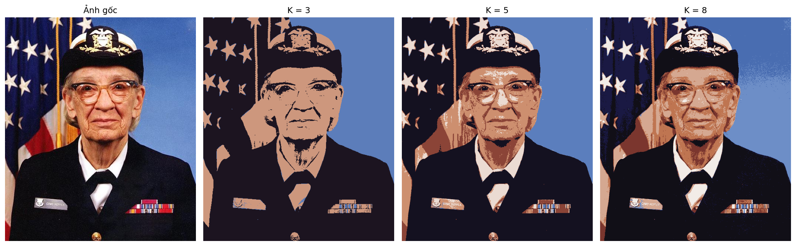

# Lab 03 bổ sung — Phân vùng ảnh theo màu

## 1. Bài toán và dữ liệu

**Mục đích:** dùng K-means nhóm các pixel gần màu nhau, sau đó thay màu từng pixel bằng màu tâm cụm. **Đầu vào:** ảnh RGB và số cụm K. **Đầu ra:** ảnh RGB có tối đa K màu đại diện cùng bảng tâm và inertia.

Ảnh minh họa Grace Hopper được lấy từ thư mục ảnh mẫu đi kèm Matplotlib trên máy và giữ nguyên tại `data/raw/grace_hopper.jpg`. Nguồn gốc và quyền tái phân phối của ảnh cần được xác minh trước khi sử dụng ngoài bài tập. Sau khi Pillow xử lý hướng EXIF và chuyển RGB, ảnh có chiều **rộng 512 × cao 600**, tức 307.200 pixel.

## 2. Chuẩn bị đặc trưng

Mỗi pixel là một vector `(R, G, B)` có ba giá trị từ 0 đến 255. Ảnh đầu vào có kích thước `600 × 512 × 3`. Để giảm chi phí huấn luyện, ảnh được thu nhỏ giữ tỷ lệ còn **rộng 102 × cao 120**, sau đó chuyển thành ma trận **12.240 × 3** bằng `reshape(-1, 3)`. Mỗi dòng ma trận là một pixel, ba cột là R, G, B.

Các kênh được giữ theo thang RGB gốc. `CustomerID`, tuổi, thu nhập, điểm chi tiêu và scaler của bài khách hàng không được đưa vào bài ảnh. Vị trí pixel cũng không được dùng, nên pixel thuộc các vật thể khác nhau nhưng gần màu có thể ở cùng cụm.

## 3. Thuật toán và triển khai

Tái sử dụng `KMeansModel` tự triển khai trong `src/model.py` của LA03, theo `__init__ → build_model → fit → predict`. Với pixel `x = (R, G, B)` và tâm `μₖ = (Rₖ, Gₖ, Bₖ)`, bình phương khoảng cách là:

```text
d²(x, μₖ) = (R − Rₖ)² + (G − Gₖ)² + (B − Bₖ)²
```

Gán pixel vào tâm có khoảng cách nhỏ nhất; cập nhật mỗi thành phần của tâm bằng trung bình thành phần đó trong cụm. Lặp đến khi thay đổi tâm không vượt `tol` hoặc chạm `max_iter`, rồi giữ nghiệm có inertia nhỏ nhất trong `n_init` lần khởi tạo.

**Inertia** là tổng bình phương khoảng cách từ pixel huấn luyện tới tâm gần nhất. So sánh trên cùng ảnh nhỏ, inertia có xu hướng giảm khi tăng K. Nó đo độ khớp màu trong không gian RGB, không đo độ đúng của ranh giới vật thể.

Sau `fit()` trên ảnh nhỏ, `predict()` gán **toàn bộ pixel của ảnh gốc** theo các lô tối đa 16.384 pixel. Màu tâm được làm tròn và giới hạn trong 0–255 trước khi tạo ảnh PNG ở độ phân giải gốc. Không dùng scaler khách hàng.

## 4. Cấu hình và kết quả thực nghiệm

Lần chạy dùng `random_state=42`, `n_init=2`, `max_iter=60`, `tol=0,0001`; thử K=3, 5, 8. Inertia dưới đây tính trên cùng **12.240 pixel của ảnh nhỏ**.

| K | Inertia ảnh nhỏ | Số vòng | Hội tụ | Số màu thực tế ảnh đầu ra |
|---:|---:|---:|---|---:|
| 3 | 32.929.658,63 | 28 | Có | 3 |
| 5 | 14.300.443,05 | 21 | Có | 5 |
| 8 | 7.898.478,59 | 26 | Có | 8 |



**Nhận xét từ ảnh:** K=3 gộp nhiều sắc độ trên khuôn mặt và cờ, còn lại các mảng màu lớn. K=5 giữ thêm vùng sáng và tối. K=8 thể hiện nhiều sắc độ trên khuôn mặt và nền hơn. Mức phù hợp của K tùy mục đích: muốn ít màu có thể chọn K nhỏ, muốn giữ thêm sắc độ có thể chọn K lớn hơn. Đây không phải kết luận về số vật thể trong ảnh.

## 5. Kiểm chứng và giới hạn

- Notebook kiểm tra số pixel và kích thước mảng, giá trị RGB và kiểu đầu ra; ảnh được khôi phục đúng **512 × 600**.
- Đã kiểm tra số màu ảnh PNG không vượt K; kết quả thực tế lần này là 3, 5 và 8 màu. Các tệp `results/segmented_k3.png`, `segmented_k5.png`, `segmented_k8.png` và `results/metrics.json` lưu bằng chứng.
- Bài chỉ nhóm màu; không hiểu ngữ nghĩa và không có nhãn vùng chuẩn để tính độ chính xác nhận diện vật thể. Tâm học trên ảnh nhỏ có thể khác khi đổi kích thước, seed hoặc tham số.
- Notebook được chạy lần lượt từ trên xuống bằng IPython. Silhouette không được tính trong lần chạy này; đề yêu cầu trực quan hóa kết quả và so sánh ảnh.
