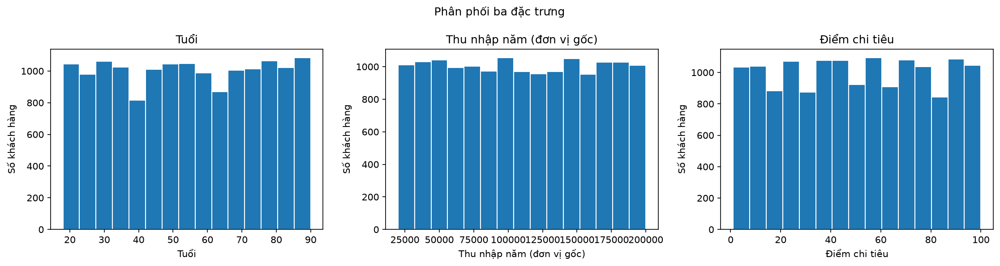
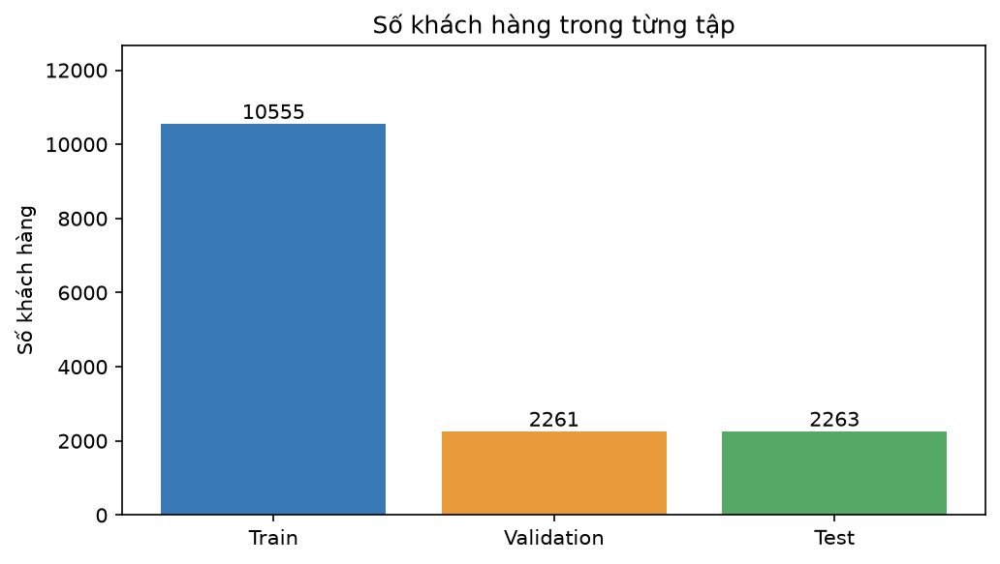
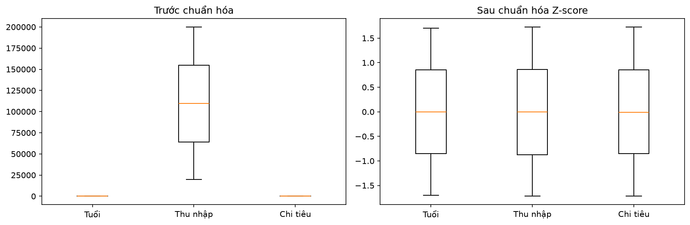
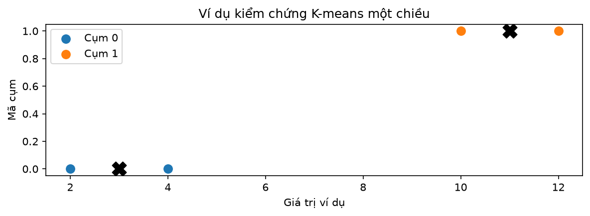
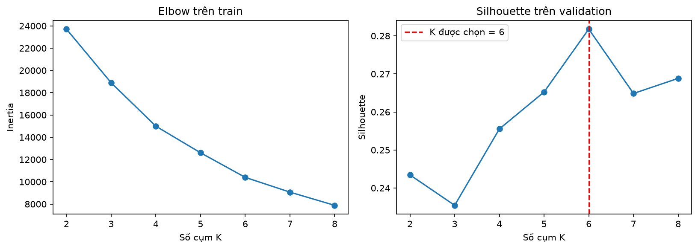
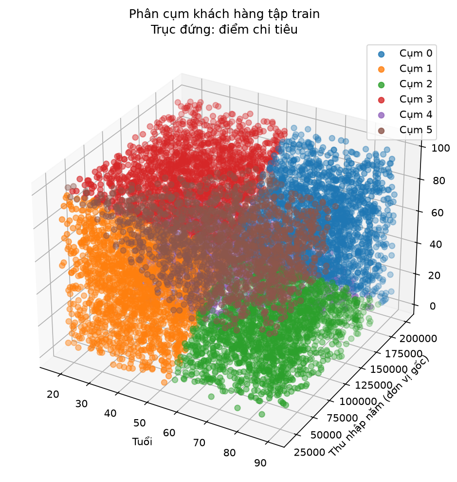

# Lab 03 — Phân cụm khách hàng bằng K-means

> Báo cáo này dựa trên lần thực nghiệm đã chạy với bộ 15.079 dòng. Các ví dụ tính tay được ghi rõ là **minh họa**, không phải dữ liệu khách hàng hay kết quả đánh giá thực tế.

## 1. Mục tiêu và định nghĩa bài toán

Một cửa hàng muốn tìm những khách hàng có đặc điểm gần nhau để mô tả các nhóm khách hàng. Bài lab sử dụng **unsupervised learning** - học không giám sát: dữ liệu không có nhãn nhóm đúng sẵn để hướng dẫn mô hình.

- **Đầu vào:** tuổi, thu nhập hằng năm và điểm chi tiêu của từng khách.
- **Đầu ra:** mã cụm của mỗi khách và tọa độ các **centroid** — tâm cụm — mô tả các nhóm tìm được.
- **Không có target:** không có cột nhãn cụm đúng để tính tỷ lệ dự đoán đúng. Số cụm 0, 1, 2… chỉ là tên nhóm, không phải thứ hạng.
- **Mô hình:** K-means tự triển khai bằng NumPy. Mục tiêu là giảm tổng bình phương khoảng cách từ các khách đến tâm cụm gần nhất.

Gọi `n` là số khách và `p = 3` là số đặc trưng. Sau khi chuẩn hóa, dữ liệu đưa vào mô hình là ma trận:

$$
X = [x_{ij}] \in \mathbb{R}^{n\times 3},\qquad
x_i=(x_{i,\text{tuổi}},x_{i,\text{thu nhập}},x_{i,\text{chi tiêu}}).
$$

Mỗi hàng `xᵢ` là một khách; mỗi cột là một đặc trưng đã chuẩn hóa. Ở lần chạy hiện tại, ma trận train có kích thước 10.555 × 3.

## 2. Thu thập và tìm hiểu dữ liệu

### 2.1. Nguồn và các cột

Tệp `data/raw/Shopping_Mall_15079.csv` được tải từ [bản sao GitHub](https://github.com/fiqritiras/mall-customer-segmentation); dự án đó ghi nguồn là [Kaggle](https://www.kaggle.com/datasets/zubairmustafa/shopping-mall-customer-segmentation-data). Năm dòng đầu và cuối khớp ảnh video được cung cấp. **Nguồn thu thập thực tế, tính đại diện và đơn vị tiền tệ chưa được xác minh.**

| Cột gốc | Ý nghĩa | Cách dùng |
|---|---|---|
| `Customer ID` | Mã khách dạng chuỗi | Đổi tên nội bộ thành `CustomerID` để truy vết; không tính khoảng cách. |
| `Age` | Tuổi | Đặc trưng thứ nhất. |
| `Gender` | Giới tính trong dữ liệu | Giữ để mô tả, không dùng làm đầu vào K-means hiện tại. |
| `Annual Income` | Thu nhập hằng năm theo đơn vị gốc | Đặc trưng thứ hai; không tự suy đoán đơn vị tiền. |
| `Spending Score` | Điểm chi tiêu | Đặc trưng thứ ba; dữ liệu có giá trị từ 1 đến 100. |

### 2.2. Kết quả EDA — Exploratory Data Analysis

**EDA** là khám phá dữ liệu: kiểm tra kích thước, kiểu, giá trị thiếu, trùng lặp, phân phối và giá trị bất thường trước khi quyết định xử lý.

| Kiểm tra trên dữ liệu gốc | Kết quả thực tế |
|---|---:|
| Số dòng / số cột | 15.079 / 5 |
| Tổng số ô thiếu | 0 |
| Dòng trùng hoàn toàn | 0 |
| Mã khách trùng | 0 |
| Male / Female | 7.595 / 7.484 |

| Đặc trưng | Nhỏ nhất | Q1 | Trung vị Q2 | Q3 | Lớn nhất | Trung bình |
|---|---:|---:|---:|---:|---:|---:|
| Tuổi | 18 | 36 | 54 | 72 | 90 | 54,19 |
| Thu nhập năm | 20.022 | 64.141 | 109.190 | 155.008 | 199.974 | 109.742,88 |
| Điểm chi tiêu | 1 | 26 | 51 | 75 | 100 | 50,59 |

Q1, Q2, Q3 là các **quartile** — tứ phân vị — tương ứng mốc 25%, 50% và 75% của dữ liệu đã sắp xếp. Ví dụ, Q1 của tuổi là 36; khoảng một phần tư số khách có tuổi không vượt mốc này. Các bảng chi tiết nằm trong `reports/data_quality.csv` và `reports/feature_statistics.csv`.

### 2.3. Công thức kiểm tra giá trị bất thường

**IQR (Interquartile Range)** là khoảng tứ phân vị:

$$
IQR=Q_3-Q_1,\qquad
L=Q_1-1{,}5\,IQR,\qquad U=Q_3+1{,}5\,IQR.
$$

Một giá trị `x < L` hoặc `x > U` được **gắn cờ** để kiểm tra, không mặc định là sai. Với tuổi, `IQR = 72 − 36 = 36`; ngưỡng là `L = −18`, `U = 126`. Tuổi thực tế nằm từ 18 đến 90 nên không có tuổi bị gắn cờ. Áp dụng cùng quy tắc cho từng cột cho kết quả **không có dòng gắn cờ** ở ba đặc trưng. Không bị gắn cờ cũng không chứng minh dữ liệu chắc chắn đúng.

Tương quan Pearson giữa hai cột X và Y được tính bằng:

$$
r_{XY}=\frac{\sum_i(x_i-\bar{x})(y_i-\bar{y})}
{\sqrt{\sum_i(x_i-\bar{x})^2}\sqrt{\sum_i(y_i-\bar{y})^2}}.
$$

`r` gần 1 thể hiện xu hướng tuyến tính cùng chiều, gần −1 là ngược chiều, gần 0 là tuyến tính yếu. Trong mẫu: tuổi–thu nhập ≈ 0,0048, tuổi–điểm chi tiêu ≈ −0,0083, thu nhập–điểm chi tiêu ≈ 0,0032. **Không suy ra quan hệ nhân quả hay kết luận không có cấu trúc phi tuyến.**

Biểu đồ phân tán ba cặp đã được bỏ vì các điểm chồng lấp quá nhiều; bảng tương quan vẫn có trong `reports/correlations.csv`. EDA trên toàn bộ mẫu là mô tả tổng quan, không dùng để tính tham số chuẩn hóa hay chọn K từ tập test.

## 3. Chia tập và chuẩn bị dữ liệu

### 3.1. Chia trước, làm sạch sau

**Mục đích:** dành dữ liệu riêng để chọn cấu hình và đánh giá. Dữ liệu được xáo trộn với `random_state=42` rồi chia **trước khi làm sạch**:

| Tập | Vai trò | Số dòng sau xử lý |
|---|---|---:|
| Train | Học thông số chuẩn hóa và tâm cụm | 10.555 |
| Validation | So sánh K và chọn cấu hình | 2.261 |
| Test | Đánh giá sau khi chọn K | 2.263 |

Tỷ lệ ban đầu là 70% / 15% / phần còn lại; số dòng làm tròn theo cách cài đặt trong `split_data()`. Không phân tầng vì không có nhãn cụm thật. Mỗi tập sau đó được làm sạch riêng: bỏ khoảng trắng ở giới tính, loại dòng trùng hoàn toàn trong tập và kiểm tra kiểu, khoảng giá trị, mã khách. Nếu thiếu dữ liệu bắt buộc hoặc cùng mã có nội dung mâu thuẫn, chương trình dừng để xem xét. Lần chạy này **không xóa dòng nào**.

### 3.2. Kiểm tra overlap — chồng lấn

Với hai tập A và B, kiểm tra cả giao mã khách và giao bộ ba đặc trưng:

$$
ID(A)\cap ID(B),\qquad Feature(A)\cap Feature(B).
$$

Nếu có overlap, các dòng liên quan ở validation hoặc test được chuyển về train; nếu trùng giữa validation và test thì các dòng liên quan ở cả hai tập được chuyển. Sau đó chỉ xóa dòng hoàn toàn giống nhau và dừng nếu cùng mã khách có nội dung mâu thuẫn. Hai người khác mã có thể tình cờ có cùng ba đặc trưng: việc chuyển cả hai về train là **quy tắc thận trọng của bài**, không chứng minh họ là cùng một người. Tỷ lệ tập có thể thay đổi sau chuyển.

**Kết quả:** cả ba cặp tập đều có 0 mã chung và 0 bộ ba đặc trưng chung trước/sau xử lý; không có dòng nào được chuyển. Xem `reports/overlap_before.csv`, `reports/overlap_moved_to_train.csv` và `reports/split_overlap.csv`.

### 3.3. Chuẩn hóa Z-score chỉ theo train

**Vấn đề:** thu nhập có giá trị số lớn hơn tuổi và điểm chi tiêu. Nếu dùng trực tiếp khoảng cách Euclid, sự khác nhau về đơn vị có thể làm một cột chi phối khoảng cách.

Với mỗi đặc trưng `j`, dùng `n_train` khách train để tính:

$$
\mu_j=\frac{1}{n_{train}}\sum_{i\in train}x_{ij},\qquad
\sigma_j=\sqrt{\frac{1}{n_{train}}\sum_{i\in train}(x_{ij}-\mu_j)^2},
\qquad z_{ij}=\frac{x_{ij}-\mu_j}{\sigma_j}.
$$

`μⱼ` là trung bình train, `σⱼ` là độ lệch chuẩn tổng thể train (`ddof=0`). Cùng `μⱼ và σⱼ` được dùng cho cả validation/test; không tính lại từ các tập đó. Lý do là tránh **data leakage** — rò rỉ thông tin từ tập đánh giá vào quá trình học.

| Đặc trưng | `μ` train | `σ` train |
|---|---:|---:|
| Tuổi | 53,983 | 21,180 |
| Thu nhập năm, đơn vị gốc | 109.714,983 | 52.281,082 |
| Điểm chi tiêu | 50,384 | 28,720 |

**Ví dụ minh họa:** một khách 75 tuổi có tuổi sau chuẩn hóa xấp xỉ `(75 − 53,983) / 21,180 ≈ 0,992`. Giá trị dương cho biết tuổi lớn hơn trung bình train khoảng 0,992 độ lệch chuẩn.

Kiểm tra: số dòng và mã khách giữ nguyên; trung bình train sau chuẩn hóa gần 0, độ lệch chuẩn tổng thể gần 1; validation/test được kiểm tra đã dùng đúng thông số train. `data/processed/train_scaler.json` lưu các thông số. Các tệp `features_scaled.csv` và `scaler.json` từ minh họa toàn mẫu trước đây không dùng để đánh giá ngoài mẫu.

## 4. Nguyên lý và triển khai K-means

### 4.1. Hàm mục tiêu

Chọn `K` cụm `C₁, …, Cₖ` và các tâm `μ₁, …, μₖ`. K-means tìm cách giảm **inertia** — tổng bình phương khoảng cách từ mỗi điểm tới tâm cụm được gán:

$$
J=\sum_{k=1}^{K}\sum_{x_i\in C_k}\|x_i-\mu_k\|_2^2
=\sum_{i=1}^{n}\min_{1\le k\le K}\sum_{j=1}^{3}(x_{ij}-\mu_{kj})^2.
$$

`xᵢⱼ` là đặc trưng thứ `j` của khách `i` sau chuẩn hóa; `μₖⱼ` là tọa độ thứ `j` của tâm cụm `k`. Inertia phụ thuộc số điểm, đặc trưng và thang đo; không so sánh số tuyệt đối giữa các tập khác kích thước như thể tương đương.

### 4.2. Trình tự hoạt động và liên hệ mã

Trong `src/model.py`, mô hình tuân theo thứ tự `__init__()` → `build_model()` → `fit(X)` → `predict(X_new)`:

1. **Khởi tạo:** `__init__()` nhận siêu tham số; `build_model()` kiểm tra giá trị. Trong `fit()`, chọn ngẫu nhiên K điểm khác giá trị làm tâm ban đầu (`init=random`).
2. **Gán cụm:** `squared_distances()` tính bình phương khoảng cách và `assign_clusters()` chọn tâm gần nhất:

$$
d^2(x_i,\mu_k)=\sum_{j=1}^{3}(x_{ij}-\mu_{kj})^2,\qquad
c_i=\arg\min_{1\le k\le K}d^2(x_i,\mu_k).
$$

3. **Cập nhật tâm:** `update_centers()` tính trung bình mỗi tọa độ của các điểm trong cụm:

$$
\mu_k^{new}=\frac{1}{|C_k|}\sum_{x_i\in C_k}x_i.
$$

Nếu cụm rỗng, mã chuyển một điểm xa tâm từ cụm có hơn một điểm sang cụm rỗng trước khi tính tâm.
4. **Điều kiện dừng:** lặp gán/cập nhật đến khi chuẩn Euclid của ma trận thay đổi tâm không vượt `tol`, hoặc đạt `max_iter`. Sau đó gán lại nhãn theo tâm cuối và tính inertia. Nếu chạm `max_iter`, tâm cuối chưa chắc là trung bình của nhãn gán lại cuối cùng.
5. **Nhiều lần khởi tạo:** chạy `n_init` lần và giữ nghiệm có inertia nhỏ nhất. `predict()` gán điểm mới đã chuẩn hóa vào tâm gần nhất mà không cập nhật tâm; nếu hòa khoảng cách, chọn tâm có chỉ số nhỏ hơn.

### 4.3. Ví dụ tính tay — không phải dữ liệu khách hàng

Cho bốn điểm một chiều 2, 4, 10, 12, chọn `K = 2`. Giả sử hai tâm hiện tại là 2 và 10:

- Gán điểm: cụm thứ nhất `{2, 4}`, cụm thứ hai `{10, 12}`.
- Tâm mới: `(2 + 4) / 2 = 3` và `(10 + 12) / 2 = 11`.
- Inertia tại các tâm này: `(2 − 3)² + (4 − 3)² + (10 − 11)² + (12 − 11)² = 4`.

Kiểm chứng bằng code cho tâm 3 và 11, inertia 4. Điểm mới 5 có khoảng cách tới 3 là 2, tới 11 là 6 nên được gán vào cụm có tâm 3.

### 4.4. Cấu hình thực nghiệm

`config.yaml` đặt `init=random`, `n_init=5`, `max_iter=300`, `tol=0,0001`, `random_state=42`. `n_clusters=3` trong phần model là **giá trị khởi đầu**, còn thực nghiệm thử K từ 2 đến 8; mỗi lần thử ghi đè K theo giá trị đang xét. Sau lựa chọn, mô hình được lưu có K=6. Giải thích chi tiết xem `docs/ReadmeForParameters.md`.

## 5. Chỉ số đánh giá và lý do lựa chọn

### 5.1. Elbow — phương pháp khuỷu tay

**Mục đích:** xem inertia train giảm ra sao khi tăng K. **Đầu vào:** các nghiệm fit trên cùng tập train đã chuẩn hóa. **Đầu ra:** đường biểu diễn `K` theo `J`.

Khi tăng K, inertia thường giảm; tìm vùng mà tốc độ giảm bắt đầu chậm lại để có gợi ý số cụm. Elbow không có một ngưỡng tự động chắc chắn và không đánh giá khả năng tách biệt ngoài mẫu. Không chọn K chỉ vì inertia nhỏ nhất.

### 5.2. Silhouette coefficient — hệ số bóng

**Mục đích:** đánh giá một điểm gần cụm của nó so với cụm khác như thế nào; chỉ số phù hợp khi không có nhãn cụm đúng.

Với điểm `i` thuộc cụm `C(i)`, dùng **khoảng cách Euclid** `d` trên dữ liệu đã chuẩn hóa:

$$
a(i)=\frac{1}{|C(i)|-1}\sum_{j\in C(i),\,j\ne i}d(x_i,x_j),
$$

$$
b(i)=\min_{C\ne C(i)}\frac{1}{|C|}\sum_{j\in C}d(x_i,x_j),\qquad
s(i)=\frac{b(i)-a(i)}{\max(a(i),b(i))},\qquad
S=\frac{1}{n}\sum_{i=1}^{n}s(i).
$$

- `a(i)`: khoảng cách trung bình tới các điểm **khác** cùng cụm; `b(i)`: khoảng cách trung bình nhỏ nhất tới một cụm khác.
- `s(i)` gần 1: điểm thường gần cụm mình hơn; gần 0: gần ranh giới; âm: trung bình gần một cụm khác hơn. Cụm một điểm được quy ước `s(i) = 0`; khi cả `a = b = 0`, mã cũng trả 0.
- Chỉ tính khi số cụm thực sự xuất hiện từ 2 đến `n − 1`. Đây không phải accuracy — độ chính xác — và không đảm bảo các nhóm có ý nghĩa kinh doanh.

**Ví dụ minh họa:** nếu `a(i) = 2`, `b(i) = 5`, thì `s(i) = (5 − 2) / 5 = 0,6`. Điểm này trung bình gần các điểm cùng cụm hơn cụm gần nhất khác.

`src/evaluate.py` tính Silhouette **trên toàn bộ điểm của từng tập validation/test**, theo các lô tối đa 128 điểm được xét để giảm bộ nhớ; mỗi điểm vẫn so với toàn bộ tập đó. Không lấy mẫu. Chỉ số nhạy với thang đo, khoảng cách và hình dạng cụm; K-means cũng phù hợp hơn khi cụm tương đối gọn quanh tâm.

## 6. Kết quả thực nghiệm và cách đọc

Thử K=2–8, fit trên **10.555 khách train**; dùng mô hình tương ứng gán cụm cho **2.261 khách validation**. Chỉ so sánh K nếu đủ K cụm xuất hiện trên validation; chọn Silhouette validation cao nhất, hòa thì chọn K nhỏ hơn. Tất cả nghiệm được giữ trong lần chạy này hội tụ.

| K | Inertia train | Silhouette validation |
|---:|---:|---:|
| 2 | 23.715,921 | 0,2435 |
| 3 | 18.897,473 | 0,2354 |
| 4 | 14.996,826 | 0,2555 |
| 5 | 12.607,289 | 0,2652 |
| **6** | **10.398,498** | **0,2818** |
| 7 | 9.071,867 | 0,2649 |
| 8 | 7.886,263 | 0,2688 |

**Đọc kết quả:** K=6 có Silhouette validation cao nhất trong khoảng đã thử. K=8 đạt 0,2688 và đường Elbow không có khuỷu thật rõ, nên K=6 là lựa chọn theo tiêu chí của lần thực nghiệm, không chứng minh có đúng sáu nhóm tự nhiên. K=6 hội tụ sau 66 vòng ở lần khởi tạo được giữ.

Chỉ sau khi chọn K, dùng mô hình đã fit trên train để gán cụm cho **2.263 khách test**: Silhouette test bằng **0,2923**, với đủ sáu cụm xuất hiện. Hai điểm validation/test dương nhưng còn xa 1: có cấu trúc theo thước đo này, song các nhóm chưa tách biệt rõ. Chưa kiểm tra độ ổn định qua nhiều cách chia; nguồn và tính đại diện dữ liệu cũng chưa xác minh.

Các kết quả được đọc từ `reports/k_selection.csv` và `reports/metrics.json`. Không dùng test để chọn K hoặc điều chỉnh tham số.

## 7. Mô tả các cụm khách hàng

Bảng là **trung bình của khách train**; thu nhập giữ đơn vị gốc chưa xác minh. Trung bình mô tả mẫu, không chứng minh nguyên nhân hay hiệu quả chiến dịch.

| Cụm | Số khách train | Tuổi TB | Thu nhập năm TB | Điểm chi tiêu TB |
|---:|---:|---:|---:|---:|
| 0 | 1.798 | 73,79 | 158.221,04 | 63,73 |
| 1 | 1.788 | 34,25 | 60.363,59 | 37,01 |
| 2 | 1.793 | 74,17 | 83.865,34 | 23,51 |
| 3 | 1.755 | 34,32 | 138.802,67 | 77,35 |
| 4 | 1.684 | 42,78 | 158.319,80 | 22,60 |
| 5 | 1.737 | 63,68 | 60.478,04 | 77,77 |

Ví dụ, cụm 0 và 4 có thu nhập trung bình gần nhau nhưng điểm chi tiêu trung bình khác nhau trong tập train. Không thể từ đây kết luận thu nhập gây ra hành vi chi tiêu; cũng không nên coi mọi khách trong cùng cụm đều giống đúng giá trị trung bình.

Hình dùng ba trục theo đơn vị gốc để dễ đọc; mô hình tính khoảng cách trên đặc trưng chuẩn hóa. Vì thang đo, góc nhìn và điểm che khuất, khoảng cách nhìn trên hình không phản ánh chính xác khoảng cách mô hình dùng.

## 8. Lưu mô hình, tracking và demo

`models/kmeans.json` lưu tâm cụm, cấu hình và thông số chuẩn hóa train. Với khách mới, `src/predict.py` nạp model/scaler, tính Z-score bằng `μ_train và σ_train` rồi gọi `predict()`. Tâm cụm hiển thị ở đơn vị gốc được đổi ngược bằng:

$$
x_j=z_j\sigma_{j,train}+\mu_{j,train}.
$$

Ví dụ **minh họa đã chạy** `(tuổi=35, thu nhập=80000, điểm chi tiêu=60)` được gán cụm 1 trong mô hình hiện tại. Đây không phải nhãn đúng của khách thật; mã cụm có thể đổi khi huấn luyện lại. `app.py` cung cấp giao diện Streamlit, còn lệnh terminal và cách chạy có trong `README.md`.

Theo cách tổ chức của Lab 01, `src/tracking.py` tạo mã lần chạy, ghi `logs/<run_id>.log`, trạng thái mới nhất trong `progress_results/`, bảng `reports/experiment_logs.csv` và bản sao cấu hình/chỉ số/model trong `reports/experiments/<run_id>/`. Chỉ lần chạy thành công được ghi vào bảng tổng hợp; lỗi được ghi trạng thái `FAILED`. Thời gian log dùng UTC. Các kết quả chung tại `reports/` và `models/` có thể bị ghi đè khi chạy lại.

## 9. Kiểm chứng và kết luận

- Notebook `notebooks/Lab03.ipynb` trình bày từ thu thập, EDA, chia tập, làm sạch, xử lý overlap đến đánh giá và demo; chạy lần lượt từ trên xuống.
- Đã đối chiếu các số trong báo cáo với `reports/metrics.json`, `k_selection.csv`, `cluster_profile.csv`, `split_overlap.csv` và `train_scaler.json`. Model được nạp lại và cho cùng nhãn test trong lần chạy.
- Đã kiểm tra việc chuyển overlap, trạng thái log khi lỗi và dự đoán demo. Mã K-means, các chỉ số và kiểm chứng dùng dữ liệu minh họa được giải thích trong notebook và mã nguồn.
- **Kết luận:** với dữ liệu và cách chia hiện tại, K=6 là ứng viên có Silhouette validation cao nhất trong K=2–8; test đạt 0,2923. Các nhóm có thể dùng để thực hành mô tả, nhưng mức tách biệt còn hạn chế và chưa đủ bằng chứng để khẳng định hiệu quả trong thực tế.
