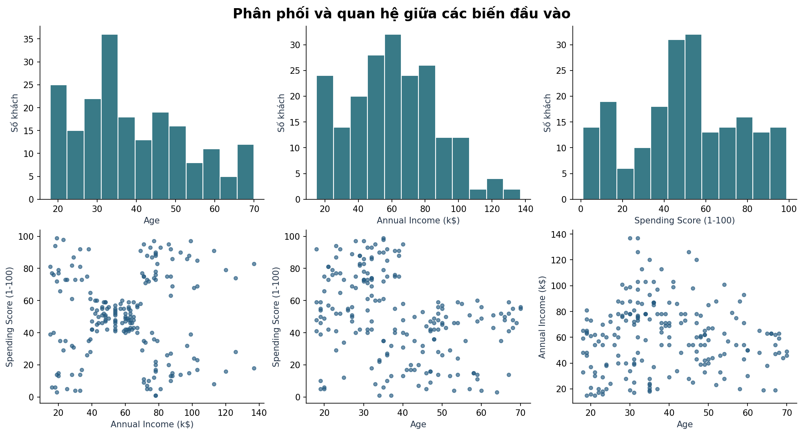
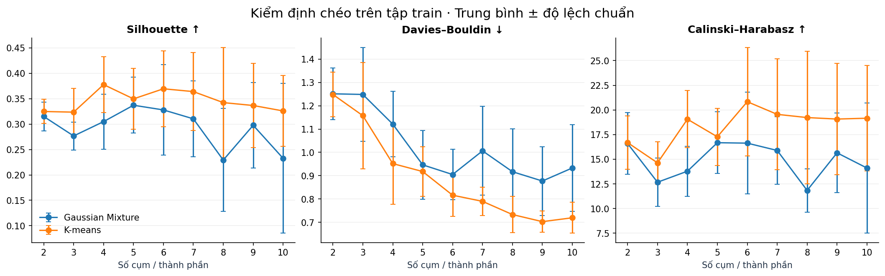
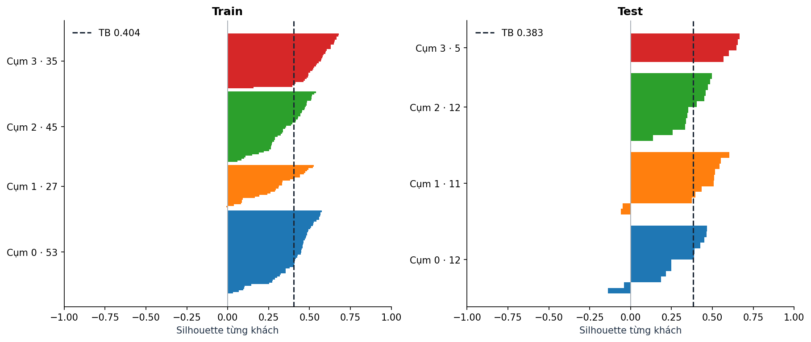
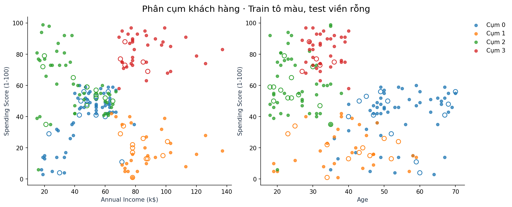
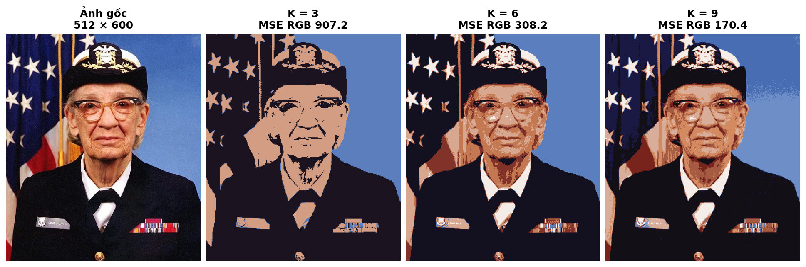

# Lab 03 · Quy trình, công thức và kết quả

Phân tích này dùng lần chạy `20261112T160608Z-052b5864` với cấu hình mặc định. Bài chính ở trang 111 của *Machine Learning Full Course* và bài ảnh ở trang 112. [Báo cáo số liệu gốc](../reports/20261112T160608Z-052b5864/results.md)

## 1. Dữ liệu và quyết định tiền xử lý

| Biến | Vai trò | Thống kê trên 200 khách |
|---|---|---|
| `CustomerID` | Kiểm tra tính duy nhất và truy vết kết quả từng khách. | 200 mã duy nhất |
| `Gender` | Mô tả cơ cấu của cụm sau khi gán nhãn. | 112 Female, 88 Male |
| `Age` | Đầu vào. | 18–70 tuổi, trung bình 38,85 |
| `Annual Income (k$)` | Đầu vào. | 15–137 nghìn USD, trung bình 60,56 |
| `Spending Score (1-100)` | Đầu vào. Điểm do nguồn dữ liệu mô tả là được gán dựa trên hành vi và dữ liệu mua hàng. | 1–99 điểm, trung bình 50,20 |

Tệp nguồn không có giá trị thiếu hay dòng trùng. Kiểm tra ngoại lệ theo khoảng `[Q1 − 1,5×IQR, Q3 + 1,5×IQR]` đánh dấu hai khách ID 199 và 200 có thu nhập 137 nghìn USD, vượt ngưỡng trên 132,75. Hai dòng được giữ vì chúng có giá trị hợp lệ và thể hiện hai kiểu chi tiêu rất khác nhau ở cùng mức thu nhập. Sau khi fit, hai khách có điểm chi tiêu 18 và 83 lần lượt vào cụm 1 và 3, với Silhouette cá nhân khoảng 0,309 và 0,396. Quy tắc IQR chỉ dùng để khám phá dữ liệu. [Nguồn và mô tả biến trên Kaggle](https://www.kaggle.com/datasets/vjchoudhary7/customer-segmentation-tutorial-in-python) · [Kết quả kiểm tra dữ liệu](../reports/20261112T160608Z-052b5864/eda.json)

Thu nhập và điểm chi tiêu có tương quan Pearson khoảng **0,010**. Scatter plot vẫn cho thấy các vùng khách có cùng mức thu nhập nhưng điểm chi tiêu rất khác nhau. Một hệ số tương quan tuyến tính toàn mẫu có thể bỏ qua cấu trúc nhóm này. Tuổi và điểm chi tiêu có Pearson khoảng **−0,327**, nên thêm tuổi vào không gian phân cụm cũng có thể tách những khách đứng gần nhau trên biểu đồ thu nhập–chi tiêu.

Pipeline dùng trung vị của phần fit để điền giá trị thiếu nếu xuất hiện, sau đó chuẩn hóa từng biến bằng `z = (x − μ_fit) / σ_fit`. Trên CSV gốc, độ lệch chuẩn mẫu của thu nhập là 26,27 và của tuổi là 13,97. Nếu dùng khoảng cách Euclid trực tiếp, chênh lệch điển hình về thu nhập sẽ có đóng góp bình phương lớn hơn tuổi chỉ vì thang đo. Chuẩn hóa đặt ba biến trên cùng thang độ lệch chuẩn. Đây là quyết định về cách đo độ tương tự. Nó ngầm cho ba biến trọng số như nhau theo đơn vị chuẩn hóa. ID phục vụ truy vết và giới tính phục vụ mô tả vì đề chỉ nêu ba biến số ở bước chuẩn hóa. [Tài liệu StandardScaler](https://scikit-learn.org/1.7/modules/generated/sklearn.preprocessing.StandardScaler.html)

## 2. Thiết kế thực nghiệm

1. Tách ngẫu nhiên 160 khách train và 40 khách test, seed 42. Bảng mô tả dữ liệu có thể xem toàn bộ CSV. Các bước fit và chọn cấu hình dùng tập train.
2. So sánh K-means và Gaussian Mixture (GMM, hiệp phương sai đầy đủ), mỗi phương pháp thử `k=2…10`. Cả hai dùng cùng năm fold và ba đặc trưng. Mỗi lượt fit bộ điền thiếu, bộ chuẩn hóa và mô hình trên 128 khách, rồi gán cụm cho 32 khách validation. Các chỉ số được tính từ điểm validation trong không gian chuẩn hóa của lượt đó.
3. Xếp hạng các cấu hình hợp lệ theo Silhouette trung bình giảm dần. Khi bằng nhau, ưu tiên độ lệch chuẩn nhỏ hơn, sau đó số cụm ít hơn. Fit lại cấu hình thắng trên toàn bộ 160 khách train. Gán nhãn cho 40 khách test bằng mô hình đã cố định.
4. Kiểm tra độ ổn định bằng 30 lần fit lại cấu hình đã chọn trên 128 khách được lấy không hoàn lại từ train. So sánh các nhãn gán trên cùng 40 khách test với nhãn từ mô hình fit trên toàn bộ train. Phép thử thay đổi mẫu fit và seed cùng lúc.

K-means gán khách vào tâm gần nhất và cập nhật mỗi tâm bằng trung bình của cụm. Hàm mục tiêu là `Σᵢ ||zᵢ − μ[cᵢ]||²`. Mô hình dễ diễn giải vì tâm cụm có thể chuyển về đơn vị gốc. GMM mô tả dữ liệu bằng hỗn hợp `p(z) = Σⱼ πⱼ N(z | μⱼ, Σⱼ)`. Với hiệp phương sai đầy đủ, các thành phần có thể khác hướng và độ trải. GMM được đưa vào để kiểm tra một cách nhóm linh hoạt hơn. Cả hai có thể gán cụm cho khách mới bằng mô hình đã lưu. [Tài liệu phân cụm scikit-learn](https://scikit-learn.org/1.7/modules/clustering.html)

## 3. Vì sao chọn từng chỉ số

### Silhouette · Tiêu chí chọn mô hình

Với một khách `i`, `a(i)` là khoảng cách trung bình đến những khách khác trong cùng cụm. `b(i)` là khoảng cách trung bình nhỏ nhất đến một cụm khác. `s(i) = (b(i) − a(i)) / max(a(i), b(i))`. Trung bình của `s(i)` trên tập đánh giá là Silhouette Score, nằm trong `[−1, 1]`. Với cụm chỉ có một điểm, scikit-learn gán Silhouette cá nhân bằng 0. Chỉ số toàn tập cần ít nhất hai cụm quan sát được và ít cụm hơn số điểm.

Chỉ số phù hợp với mục tiêu tìm nhóm khách giống nhau vì đo đồng thời độ gần trong cụm và khoảng cách tới cụm lân cận, trên chính ba đặc trưng dùng để fit. Nó cho phép so sánh K-means và GMM sau khi hai mô hình gán nhãn, đồng thời truy ra từng khách có `s(i) < 0`. Với một khách có điểm âm, khoảng cách trung bình đến một cụm khác nhỏ hơn khoảng cách trung bình đến cụm được gán. K-means dùng khoảng cách tới **tâm cụm** để gán nhãn, nên hai cách đo này có thể cho kết quả khác nhau. Silhouette có xu hướng thuận lợi cho các cụm gọn và tách biệt theo khoảng cách Euclid. Giá trị 0,383 không biểu thị tỷ lệ dự đoán đúng 38,3%. [Tài liệu Silhouette](https://scikit-learn.org/1.7/modules/generated/sklearn.metrics.silhouette_score.html)

### Davies–Bouldin · Kiểm tra cặp cụm khó tách

Gọi `Sᵢ` là khoảng cách trung bình của các điểm trong cụm `i` tới tâm cụm đó, và `Mᵢⱼ` là khoảng cách giữa hai tâm. Với mỗi cụm, lấy `maxⱼ≠ᵢ (Sᵢ + Sⱼ) / Mᵢⱼ`, rồi lấy trung bình qua các cụm. **Thấp hơn** cho thấy độ trải của các cụm nhỏ hơn so với khoảng cách giữa các tâm.

Davies–Bouldin bổ sung góc nhìn theo cụm. Mỗi cụm có trọng số ngang nhau trong trung bình, còn Silhouette trung bình theo số khách. Chỉ số này dựa trên tâm và độ trải nên có thể ưu tiên việc tách một nhóm rộng thành nhiều nhóm gọn. Khi validation chỉ có 32 khách, cần đọc chỉ số cùng số cụm thực sự xuất hiện và quy mô cụm nhỏ nhất. [Tài liệu Davies–Bouldin](https://scikit-learn.org/1.7/modules/generated/sklearn.metrics.davies_bouldin_score.html)

### Calinski–Harabasz · Kiểm tra độ tách toàn cục

Chỉ số tính `(B / (k−1)) / (W / (n−k))`, với `B` là tổng bình phương khoảng cách giữa tâm từng cụm và tâm toàn tập, có trọng số theo kích thước cụm. `W` là tổng bình phương khoảng cách của các điểm tới tâm cụm tương ứng. `n` là số điểm và `k` là số cụm quan sát được. **Cao hơn** cho thấy độ phân tán giữa cụm lớn hơn so với độ phân tán trong cụm.

Chỉ số đo cấu trúc chung, bổ sung cho khoảng cách tới cụm lân cận của Silhouette. So sánh giữa các cấu hình dùng cùng fold, vì `n` xuất hiện trực tiếp trong công thức. So sánh giá trị train và test cần tính đến chênh lệch cỡ mẫu 160 so với 40. [Tài liệu Calinski–Harabasz](https://scikit-learn.org/1.7/modules/generated/sklearn.metrics.calinski_harabasz_score.html)

### Adjusted Rand Index · Kiểm tra độ ổn định

ARI so sánh hai cách phân cụm trên cùng tập khách qua các cặp điểm. Nó đo mức đồng thuận của việc hai khách cùng nhóm hay khác nhóm, có hiệu chỉnh mức đồng thuận kỳ vọng do ngẫu nhiên. Hai cách phân nhóm giống hệt nhau có ARI bằng 1, kể cả khi số hiệu cụm đổi chỗ. Giá trị gần 0 biểu thị mức đồng thuận gần ngẫu nhiên. Giá trị âm cũng có thể xảy ra.

ARI dùng ở đây để xem khách có tiếp tục được nhóm với nhau khi thay đổi mẫu huấn luyện và khởi tạo. Cả hai phân hoạch đều do mô hình tạo ra trên cùng 40 khách. Đề không cung cấp nhãn phân khúc chuẩn để tính accuracy, precision, recall hay F1. [Tài liệu Adjusted Rand Index](https://scikit-learn.org/1.7/modules/generated/sklearn.metrics.adjusted_rand_score.html)

## 4. Đọc bảng so sánh cấu hình

| Cấu hình | Silhouette ↑, trung bình ± độ lệch chuẩn | Davies–Bouldin ↓ | Calinski–Harabasz ↑ |
|---|---:|---:|---:|
| **K-means, 4 cụm** | **0,378 ± 0,055** | 0,952 | 19,061 |
| K-means, 6 cụm | 0,370 ± 0,074 | 0,816 | **20,834** |
| K-means, 9 cụm | 0,337 ± 0,083 | **0,703** | 19,076 |
| GMM, 5 thành phần | 0,337 ± 0,055 | 0,946 | 16,678 |

- **K-means 4 cụm** có Silhouette trung bình cao nhất trong 18 cấu hình, đủ bốn cụm trên cả năm fold. Cụm nhỏ nhất có ít nhất ba khách ở từng fold.
- **K-means 6 cụm** đạt Calinski–Harabasz cao nhất và có Davies–Bouldin thấp hơn cấu hình 4 cụm. Nó thắng 4 cụm về Silhouette ở 3/5 fold, nhưng thua nhiều hơn ở hai fold còn lại, khiến trung bình thấp hơn khoảng **0,008** và biến động lớn hơn. Một fold chỉ có một khách ở cụm nhỏ nhất. Khoảng cách 0,008 nhỏ so với biến động qua các fold, vì vậy bằng chứng chưa đủ để khẳng định 4 cụm sẽ luôn vượt 6 cụm trên một phép chia khác.
- **K-means 9 cụm** có Davies–Bouldin thấp nhất, nhưng chỉ thấy tám cụm ở ba fold validation. Thêm tâm có thể cho các nhóm gọn hơn trên các điểm quan sát được. Sự vắng mặt của một cụm ở nhiều fold làm giảm bằng chứng cho cách chia chín nhóm trên tập nhỏ.
- **GMM 5 thành phần** có Silhouette cao nhất trong nhóm GMM và thấp hơn K-means 4 cụm khoảng **0,041**. So sánh này cho biết chất lượng theo khoảng cách Euclid của các nhãn cứng. Hàm mục tiêu mật độ của GMM và khả năng mô tả cụm kéo dài chưa được đánh giá bằng một thực nghiệm riêng.

Chọn bốn cụm theo tiêu chí đã định trước và giữ cấu hình đó khi mở tập test. [Bảng đầy đủ 18 cấu hình](../reports/20261112T160608Z-052b5864/cv_summary.csv) · [Kết quả từng fold](../reports/20261112T160608Z-052b5864/cv_folds.csv)

## 5. Kết quả trên khách chưa dùng để fit

| Tập | Số khách | Cụm quan sát | Silhouette ↑ | Davies–Bouldin ↓ | Calinski–Harabasz ↑ | Số khách có Silhouette âm |
|---|---:|---:|---:|---:|---:|---:|
| Train | 160 | 4 | 0,404 | 0,941 | 98,746 | 1/160 |
| Test | 40 | 4 | 0,383 | 0,872 | 26,444 | 4/40 |

Silhouette giảm **0,021** từ train sang test và test vẫn có đủ bốn cụm. Kết quả cho thấy độ tách dương ở mức vừa trên cách chia đã dùng. Davies–Bouldin test thấp hơn train khoảng **0,069**, trong khi tỷ lệ điểm Silhouette âm tăng từ **0,625%** lên **10%**. Hai kết quả có thể cùng xảy ra vì Davies–Bouldin tính theo tâm và độ trải của từng cụm, còn Silhouette cá nhân phản ánh vị trí từng khách so với cụm lân cận. Cụm nhỏ nhất trên test chỉ có năm khách. Giá trị Calinski–Harabasz thấp hơn trên test cần được đọc cùng kích thước mẫu và cấu trúc cụm quan sát được. [Số liệu đánh giá](../reports/20261112T160608Z-052b5864/metrics.json)

Bốn khách test có Silhouette âm là ID 94 và 129 ở cụm 0, ID 125 và 133 ở cụm 1. ID 129 có giá trị thấp nhất, khoảng **−0,138**. Khách này 59 tuổi, thu nhập 71 nghìn USD và điểm chi tiêu 11. Tuổi gần hồ sơ cụm 0 hơn, còn thu nhập và mức chi tiêu kéo về vùng khách của cụm 1. Đây là trường hợp nên đọc hồ sơ khách bên cạnh nhãn cụm nếu dùng kết quả để phân tích hành vi. [Kết quả từng khách test](../data/processed/20261112T160608Z-052b5864/test.csv)

**Độ ổn định.** Trong 30 lượt lấy lại mẫu train, 28 lượt đạt ARI **1,000** và hai lượt đạt khoảng **0,925**. Trung bình **0,995**, trung vị **1,000**. Cách nhóm 40 khách test ít thay đổi khi fit lại với 80% train. Các mẫu train con chồng lấp nhiều và tập test được giữ cố định. Kết quả này mô tả độ nhạy với thay đổi vừa phải trên dữ liệu hiện có. [Kết quả 30 lượt lấy mẫu](../reports/20261112T160608Z-052b5864/stability.csv)

## 6. Hồ sơ khách hàng và độ phù hợp

Các giá trị trung bình dưới đây lấy từ train, trên thang đo gốc. Tên mô tả dùng đặc điểm tương đối giữa bốn cụm của mẫu.

| Cụm | Train / test | Tuổi trung bình | Thu nhập trung bình (nghìn USD/năm) | Điểm chi tiêu trung bình | Hồ sơ |
|---|---:|---:|---:|---:|---|
| 0 | 53 / 12 | 53,9 | 47,5 | 40,0 | Lớn tuổi nhất, điểm chi tiêu dưới trung bình toàn mẫu |
| 1 | 27 / 11 | 38,9 | 87,9 | 19,6 | Thu nhập cao, điểm chi tiêu thấp nhất |
| 2 | 45 / 12 | 25,7 | 38,9 | 61,2 | Trẻ nhất, thu nhập thấp nhất, điểm chi tiêu tương đối cao |
| 3 | 35 / 5 | 33,1 | 87,3 | 82,3 | Thu nhập cao, điểm chi tiêu cao nhất |

Cụm 1 và 3 có thu nhập trung bình gần nhau, trong khi điểm chi tiêu trung bình lệch khoảng **62,6 điểm**. Đây là sự khác biệt dễ diễn giải nhất. Cụm 3 có Silhouette trung bình cao nhất ở train (**0,549**) và test (**0,627**), dù test chỉ có năm khách thuộc cụm này. Cụm 0 có Silhouette test thấp nhất (**0,276**) và hai điểm âm. Khi các điểm chồng lấn ở một biểu đồ hai chiều, mô hình vẫn sử dụng chiều đặc trưng thứ ba để quyết định.

**Mức độ phù hợp.** K-means 4 cụm phù hợp làm mô hình phân khúc thăm dò cho mẫu Mall Customers. Các cụm có quy mô train từ 27 đến 53 khách, hồ sơ khác nhau trên đơn vị gốc và cách gán cụm ổn định trong phép thử lấy mẫu lại. Cụm 0 và 1 có vùng ranh giới cần xem xét. Với 200 khách từ một bộ dữ liệu học tập và ba biến số, kết quả chỉ hỗ trợ mô tả mẫu và thử gán cụm cho khách có đầu vào tương tự. Chưa có dữ liệu theo thời gian, cửa hàng khác hoặc kết quả chiến dịch để kiểm tra độ bền của phân khúc và hiệu quả kinh doanh. Điểm chi tiêu là điểm hành vi do nguồn cung cấp, nên các khác biệt về điểm không định lượng trực tiếp số tiền khách đã chi.

## 7. Bài bổ sung · Phân đoạn ảnh

Dùng ảnh mẫu `grace_hopper.jpg` của Matplotlib, kích thước **512 × 600**. Pipeline đọc ảnh bằng Pillow, chuyển sang RGB, thu nhỏ xuống **273 × 320** rồi chuyển thành ma trận **87.360 × 3**. K-means nhóm pixel theo khoảng cách Euclid trong RGB. Mỗi pixel được thay bằng tâm màu của cụm và ma trận được đưa lại về hình dạng ảnh thu nhỏ. Ảnh xuất được phóng về **512 × 600** bằng nội suy láng giềng gần nhất để giữ đúng bảng màu. [Ảnh mẫu trong tài liệu Matplotlib](https://matplotlib.org/stable/gallery/images_contours_and_fields/image_demo.html)

| Số cụm màu | MSE RGB ↓ | Quan sát |
|---:|---:|---|
| 3 | 907,23 | Nền xanh, vùng tối và tông da hiện thành các mảng lớn. Chi tiết sáng nhỏ trên trang phục bị gộp. |
| 6 | 308,19 | Thêm vùng sáng và tông đỏ nâu, giúp nhìn rõ hơn các mảng trên trang phục và khuôn mặt. |
| 9 | 170,37 | Giữ thêm sắc độ xanh ở nền và sắc độ da, với bảng màu lớn hơn. |

MSE RGB là trung bình bình phương chênh lệch theo cả ba kênh giữa ảnh đã thu nhỏ và ảnh tái tạo ở cùng kích thước, trước bước phóng to. Chỉ số phù hợp để đo sai số tái tạo màu. Từ 3 lên 6 màu, MSE giảm khoảng **66%** và từ 6 lên 9 màu giảm thêm khoảng **45%**. Với ảnh này, 6 màu giữ các mảng chính và một phần chi tiết bằng bảng màu nhỏ. Nếu ưu tiên độ trung thực màu, 9 màu có sai số thấp nhất trong ba giá trị đã thử. Vì vector đầu vào chỉ chứa RGB, các pixel cách xa nhau vẫn có thể cùng cụm khi màu tương tự. MSE không đo mức trùng khớp với đường viền hoặc vùng ngữ nghĩa của vật thể. [Số liệu bài ảnh](../reports/image_segmentation/metrics.csv)
